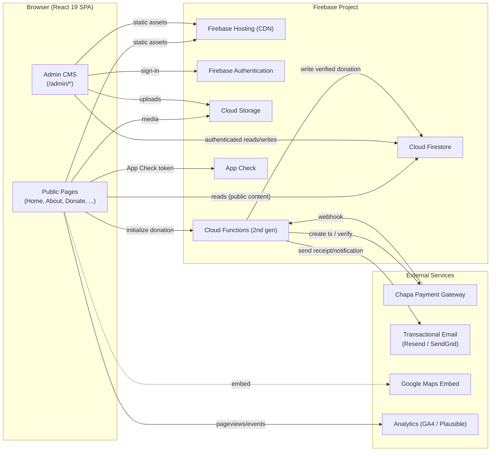
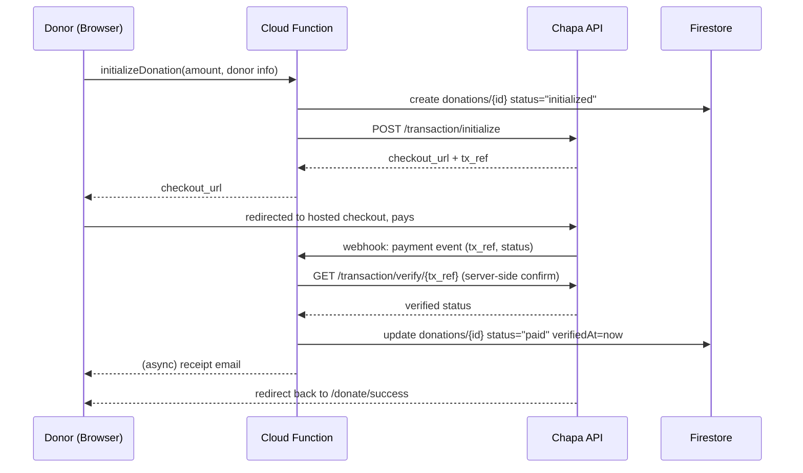

# Architecture — Selihom Mental Health Patients Resource Center Website

> Status: Draft v1.0 · Last updated: 2026-08-11
> Depends on: `research.md`, `specification.md`. Feeds: `roadmap.md`, `todo.md`, and the actual codebase.

---

## 1. High-Level Architecture



**Shape:** a statically hosted single-page application (SPA) talking directly to Firebase's client SDKs for public reads and authenticated admin writes, with a small set of Cloud Functions reserved for the operations that must never trust the client — payment verification and privileged notification/email sends. This keeps the system almost entirely serverless, keeps hosting costs near-zero, and keeps the attack surface small (see §5).

---

## 2. Frontend Architecture

### 2.1 Stack

- **React 19** (function components, hooks, `use`/Actions where they simplify form submission state).
- **Vite 7** as the build tool, with `@tailwindcss/vite` as a first-party plugin (Tailwind v4 — no `tailwind.config.js` required by default; theme tokens live in CSS via `@theme`).
- **TypeScript 5.9**, strict mode on.
- **React Router v7** for client-side routing, including a protected-route wrapper for `/admin/*`.
- **TanStack Query v5** for all Firestore reads/writes that benefit from caching, background refetch, and optimistic updates (CMS lists, donation log, volunteer inbox).
- **Zustand** for small, non-server UI state (active language, mobile nav open/closed, toast queue).
- **React Hook Form + Zod** for every form (donation, volunteer, contact, newsletter, CMS editors) — Zod schemas are shared between client-side validation and (re-declared, mirrored) Cloud Functions input validation so the two never silently drift.
- **react-i18next** for EN/AM string management, with locale JSON files plus CMS-stored bilingual content fields (see §4).
- **Tailwind CSS v4** for styling (see `design.md` for the design tokens themselves).

### 2.2 Folder Structure

```
selihom-website/
├── public/
│   ├── favicon.svg
│   ├── robots.txt
│   └── fonts/                     # self-hosted Ethiopic + Latin fonts (see design.md)
├── src/
│   ├── main.tsx
│   ├── App.tsx
│   ├── routes/
│   │   ├── router.tsx              # React Router route tree
│   │   ├── public/                 # Home, About, Services, Donate, ...
│   │   └── admin/                  # Admin dashboard, CMS editors, guarded
│   ├── components/
│   │   ├── ui/                     # Button, Card, Input, Modal, Badge, Alert...
│   │   ├── layout/                 # Header, Footer, LanguageSwitcher, Nav
│   │   └── sections/                # HomeHero, ImpactStats, DonateWidget...
│   ├── features/
│   │   ├── donations/               # DonateForm, useCreateDonation, types
│   │   ├── volunteers/              # VolunteerForm, useSubmitVolunteer
│   │   ├── content/                 # Blog/Events/Gallery/Stories queries
│   │   ├── auth/                    # useAuth, RequireRole, login screen
│   │   └── admin-cms/                # Editors for each content collection
│   ├── lib/
│   │   ├── firebase.ts              # Firebase app + SDK initialization
│   │   ├── queryClient.ts           # TanStack Query client config
│   │   └── analytics.ts
│   ├── i18n/
│   │   ├── index.ts
│   │   ├── en.json
│   │   └── am.json
│   ├── types/                       # Shared TS types / Zod schemas
│   └── styles/
│       └── index.css                 # @import "tailwindcss"; @theme { ... }
├── functions/                        # Cloud Functions (2nd gen), separate TS project
│   ├── src/
│   │   ├── index.ts
│   │   ├── donations/
│   │   │   ├── initializeChapaTransaction.ts   # callable function
│   │   │   └── chapaWebhook.ts                 # HTTPS function (webhook)
│   │   ├── notifications/
│   │   │   ├── onVolunteerApplication.ts       # Firestore trigger -> email
│   │   │   └── onContactMessage.ts             # Firestore trigger -> email
│   │   └── admin/
│   │       └── setStaffRole.ts                 # callable, admin-only
│   └── package.json
├── firestore.rules
├── firestore.indexes.json
├── storage.rules
├── firebase.json
├── .firebaserc
└── .github/workflows/deploy.yml
```

### 2.3 State & Data Flow

- **Public content** (posts, events, gallery, stories, impact numbers, settings) is read directly by the client from Firestore via TanStack Query hooks — no function needed, since these reads are safe under `allow read: if true` rules for published-only documents.
- **Privileged writes** (CMS content, staff role assignment) go through the authenticated Firestore SDK directly, protected by security rules keyed on custom claims — a Cloud Function is not required here since Firestore rules are sufficient and cheaper than round-tripping through a function.
- **Donations** are the one flow that must not trust the client at all: the client calls a Cloud Function to *initialize* a transaction, Chapa's webhook independently confirms payment, and only the Function-side webhook handler is allowed to write a donation's status as `paid` (see §6).
- **Volunteer/contact submissions** are written directly to Firestore by the (unauthenticated) client under a rule that allows `create` but not `read`/`update`/`delete` — a Firestore trigger function then fires the staff-notification email, keeping the public form simple while still gating the email side-effect through trusted server code.

---

## 3. Backend Architecture (Firebase)

| Service | Role in this project |
|---|---|
| **Firebase Authentication** | Staff sign-in only (email/password or Google). No public account creation. Roles (`editor`, `admin`) assigned via custom claims through an admin-only callable function. |
| **Cloud Firestore** | Primary datastore for all structured content and submissions — see data model in §4. |
| **Cloud Storage** | Media files: blog/gallery images, press fact-sheet PDF, staff-uploaded assets. Served through Storage's CDN-backed download URLs; images additionally optimized at upload time (resize + WebP/AVIF) via a Cloud Function trigger. |
| **Cloud Functions (2nd gen)** | Only for logic that must run server-side: Chapa transaction init + webhook verification, Firestore-triggered notification emails, staff role assignment. Deliberately kept small — everything that *can* be a direct, rules-protected Firestore read/write *is* one, per current (2026) Firebase best practice of using Functions for events/webhooks and keeping the client thin but not function-happy. |
| **Firebase Hosting** | Serves the built Vite SPA via global CDN, with SPA rewrite (`"rewrites": [{"source": "**", "destination": "/index.html"}]`), custom domain, and preview channels for PR review. Firebase App Hosting was considered and rejected for v1 — it's built for server-rendered frameworks (Next.js/Angular); this project is a client-rendered SPA and Hosting+Functions is the simpler, cheaper fit (see `research.md` §3.5). |
| **Firebase App Check** | Attached to Firestore, Storage, and callable Functions to reject traffic that isn't the real web app (mitigates scripted abuse of public write endpoints like the volunteer/contact forms). |
| **Firebase Analytics / GA4** | Pageview and conversion-funnel tracking (donation start → payment success, volunteer form start → submit). |

---

## 4. Data Model (Cloud Firestore)

All bilingual content fields use a nested `{ en: string, am: string }` shape rather than separate documents per locale, so a single document is always the unit of truth for one piece of content.

```
users/{uid}
  - email, displayName
  - role: "editor" | "admin"          (mirrored into custom claims; doc copy for UI display)
  - createdAt

posts/{postId}
  - title: { en, am }
  - slug: string
  - body: { en, am }                   (rich text / markdown)
  - coverImageUrl: string
  - category: string
  - status: "draft" | "published"
  - publishedAt, updatedAt
  - authorUid

events/{eventId}
  - title: { en, am }
  - description: { en, am }
  - startAt, endAt
  - location: { en, am }
  - coverImageUrl
  - status: "draft" | "published"

gallery/{itemId}
  - caption: { en, am }
  - imageUrl
  - tags: string[]
  - patientLinked: boolean
  - consentConfirmed: boolean          (must be true if patientLinked = true — enforced in rules + UI)
  - status: "draft" | "published"

stories/{storyId}
  - title: { en, am }
  - body: { en, am }
  - patientLinked: boolean
  - consentConfirmed: boolean          (see FR-19 in specification.md)
  - status: "draft" | "published"

siteSettings/impactNumbers            (single document)
  - patientsSupported: number
  - mealsServed: number
  - volunteersActive: number
  - lastUpdatedBy, lastUpdatedAt

volunteerApplications/{appId}
  - fullName, email, phone
  - type: "skills" | "general"
  - skills: string[]
  - availability: string
  - message: string
  - status: "new" | "contacted" | "scheduled" | "archived"
  - submittedAt

contactMessages/{msgId}
  - name, email, phone (optional)
  - subject, message
  - status: "new" | "read" | "archived"
  - submittedAt

newsletterSubscribers/{subscriberId}
  - email
  - confirmed: boolean
  - subscribedAt

donations/{donationId}
  - amount, currency ("ETB" | "USD")
  - donorName (or "Anonymous")
  - donorEmail
  - frequency: "one_time" | "monthly"
  - chapaTxRef: string
  - status: "initialized" | "paid" | "failed"   (only the webhook function may set "paid")
  - createdAt, verifiedAt
```

### 4.1 Indexes

Composite indexes are needed for: `posts` filtered by `status == "published"` ordered by `publishedAt desc`; same pattern for `events` and `stories`; `volunteerApplications` filtered by `status` ordered by `submittedAt desc`. Declared in `firestore.indexes.json` and deployed via the Firebase CLI as part of CI/CD.

---

## 5. Security Model

**Default posture: deny by default, allow narrowly.** Every collection rule is written as an explicit allow, never a blanket allow, per current Firebase guidance to "never trust the frontend."

Representative excerpt (`firestore.rules`) — illustrative, not exhaustive:

```
rules_version = '2';
service cloud.firestore {
  match /databases/{database}/documents {

    function isSignedIn() { return request.auth != null; }
    function role() { return request.auth.token.role; }
    function isEditor() { return isSignedIn() && (role() == 'editor' || role() == 'admin'); }
    function isAdmin() { return isSignedIn() && role() == 'admin'; }

    match /posts/{postId} {
      allow read: if resource.data.status == 'published' || isEditor();
      allow write: if isEditor();
    }

    match /gallery/{itemId} {
      allow read: if resource.data.status == 'published' || isEditor();
      allow create, update: if isEditor()
        && (request.resource.data.patientLinked == false
            || request.resource.data.consentConfirmed == true);
      allow delete: if isAdmin();
    }

    match /volunteerApplications/{appId} {
      allow create: if true;                 // public can submit
      allow read, update, delete: if isEditor();
    }

    match /donations/{donationId} {
      allow read: if isAdmin();
      allow write: if false;                 // only Cloud Functions (Admin SDK) may write
    }

    match /users/{uid} {
      allow read: if isSignedIn() && (request.auth.uid == uid || isAdmin());
      allow write: if isAdmin();
    }
  }
}
```

Key decisions this encodes:

- `donations` is fully closed to client writes — only the Admin SDK inside a Cloud Function (which bypasses security rules) can write, which is what forces payment status to be verified server-side rather than trusted from the browser.
- The `gallery` consent rule enforces FR-19 (`specification.md`) at the database layer, not just in the admin UI, so a bug in the CMS front-end can't bypass the consent requirement.
- `volunteerApplications`/`contactMessages` allow public `create` but never public `read` — anyone can submit, no one but staff can browse other people's submissions.

Storage rules follow the same shape: public `read` on published media paths, `write` restricted to authenticated editors/admins, with a file-size and content-type check to prevent abuse.

**App Check** is enforced on Firestore, Storage, and all callable Cloud Functions so that only requests originating from the deployed web app (verified via reCAPTCHA Enterprise or a similar attestation provider) are accepted — this is the layer that protects the public "create" endpoints (volunteer, contact, newsletter) from scripted spam, on top of the rules above.

---

## 6. Payment Integration — Chapa Donation Flow



Non-negotiable rule: **a donation is only ever marked `paid` after the Cloud Function independently calls Chapa's server-to-server verify endpoint** — the client-side redirect back to `/donate/success` is a UX nicety, never the source of truth, since redirect parameters are not trustworthy on their own (this mirrors standard Ethiopian-payment-integration guidance to always verify server-side rather than trusting browser return parameters).

Currency handling: donations are collected in ETB by default (matching Chapa's primary rails) with an optional USD-denominated path for diaspora donors if/when Chapa's international card support is confirmed eligible for the client's merchant account — flagged as an open question in `research.md` §4.

---

## 7. CI/CD & Environments

- **Environments:** three separate Firebase projects — `selihom-dev`, `selihom-staging`, `selihom-prod` — so security-rule and function changes are never tested against real donor/volunteer data.
- **GitHub Actions** pipeline (`.github/workflows/deploy.yml`):
  1. On every PR: install, typecheck, lint, unit tests, build → deploy to a **Firebase Hosting preview channel** (auto-expiring) for reviewer sign-off.
  2. On merge to `main`: build → deploy to `selihom-staging` automatically; deploy to `selihom-prod` on a manual approval gate (GitHub Environments protection rule) or a tagged release.
  3. Cloud Functions and Firestore rules/indexes deploy from the same pipeline via `firebase deploy --only functions,firestore:rules,firestore:indexes,storage` so rules and code never drift out of sync.
- **Secrets:** Chapa API keys and email-provider keys stored in Cloud Functions secret config (Secret Manager) and GitHub Actions encrypted secrets — never committed, never shipped to the client bundle.

---

## 8. Performance, Cost, and Scaling Notes

- Firebase Hosting's CDN plus a small, code-split SPA bundle is the main lever for the mobile-performance NFR in `specification.md` §5 — route-level code splitting (React Router lazy routes) keeps `/admin/*` code out of the public bundle entirely.
- Images are the single biggest payload risk on low-bandwidth connections; a Cloud Storage upload trigger generates resized WebP/AVIF variants so the client never ships a full-resolution original to a phone.
- At the traffic scale expected for an NGO site (thousands, not millions, of monthly visitors), Firestore reads/Functions invocations/Hosting bandwidth comfortably fit inside Firebase's free/Blaze pay-as-you-go low tier; the main cost driver to watch is Cloud Functions invocations if the volunteer/contact/donation forms are hit by spam, which is exactly what App Check in §5 is there to prevent.
- If traffic or write volume grows well beyond that (e.g., a viral fundraising moment), the architecture's main scaling lever is Firestore's automatic horizontal scaling plus optional multi-region configuration — no re-architecture needed for the traffic levels realistically anticipated in `roadmap.md`.

---

## 9. Explicitly Deferred Architecture Decisions

Carried from `specification.md` §9, listed here so they're not silently forgotten:

- Direct telebirr/CBE Birr integration (beyond Chapa's aggregation) — revisit if Chapa fee/eligibility terms don't work for the client.
- Server-side rendering / Firebase App Hosting migration — only worth it if SEO needs outgrow what a well-configured SPA + prerendered meta tags can deliver.
- A dedicated search index (e.g., Algolia) for blog/story content — not justified until the content volume makes Firestore's basic querying insufficient.
